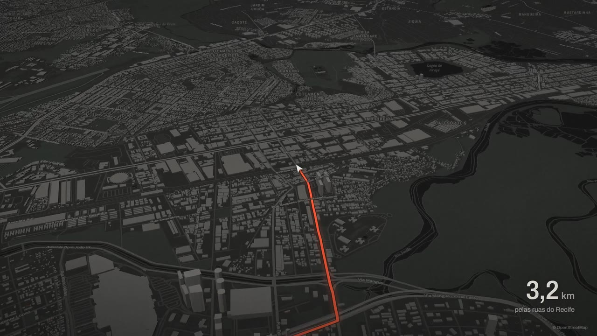
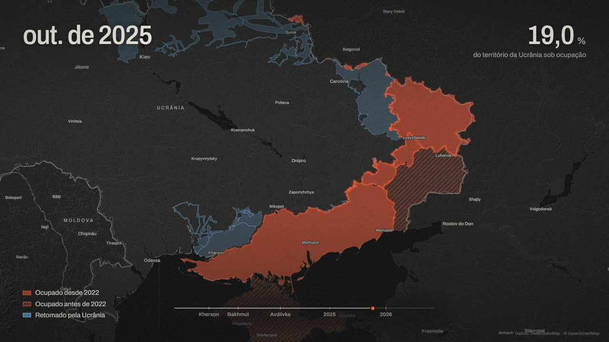
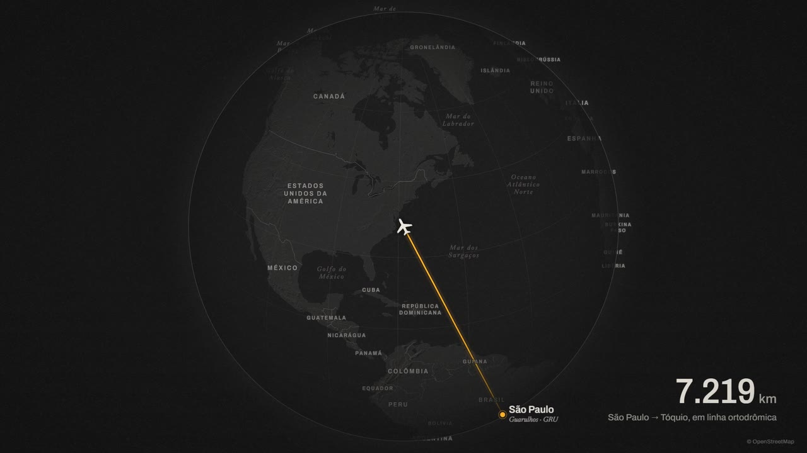
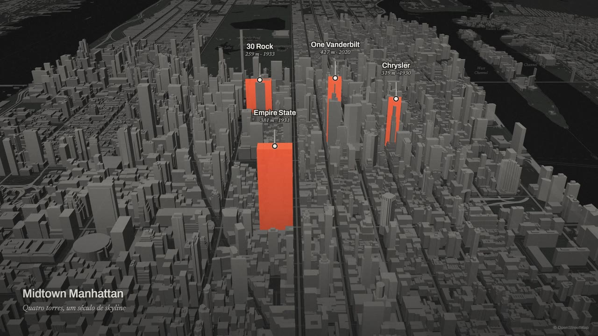
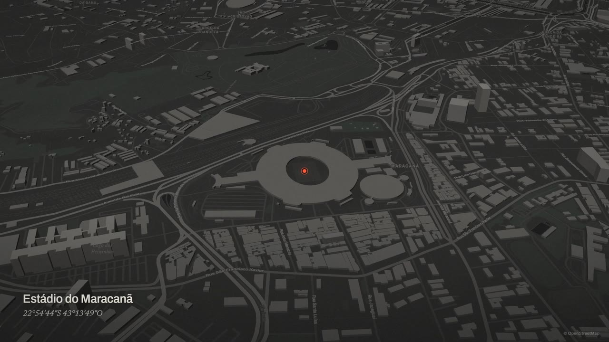
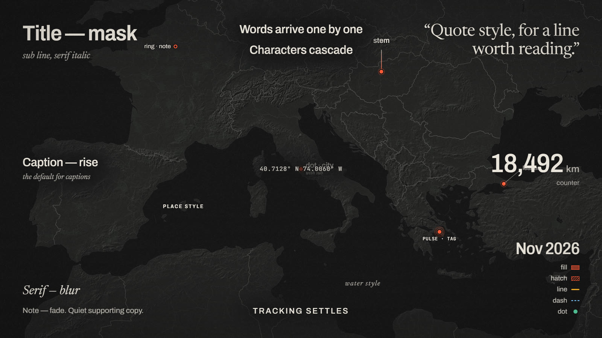

<h1 align="center">map-bamba</h1>

<p align="center">
  <b>Code-driven 2D and 2.5D map animations on real map data.</b><br>
  Real streets, real buildings, real places — written as one small file, built to be driven by AI agents.
</p>

<p align="center">
  
</p>

<p align="center">
  <a href="#quick-start">Quick start</a> ·
  <a href="#gallery">Gallery</a> ·
  <a href="#for-ai-agents">For AI agents</a> ·
  <a href="AGENTS.md">Full API</a> ·
  <a href="https://github.com/MusicMaster4/map-bamba/releases/tag/v0.1.0">Watch the videos</a>
</p>

---

map-bamba is to maps what Manim is to maths: you describe a scene in code and get a finished,
broadcast-looking video. A scene is a single JavaScript file. The framework brings the map (the whole
planet, down to individual buildings), the data tools (routing, geocoding, real establishments,
borders, terrain), the motion, the typography and the renderer.

```js
// scenes/recife.js — a real route through real streets, in 2.5D
export const config = { duration: 20, buildings: '3d', lang: 'pt', locale: 'pt-BR' };

export default async (s) => {
  const route = await s.route(['Praça de Boa Viagem, Recife', 'Praça de Casa Forte, Recife']);
  const [a, b] = route.stops;

  s.camera.set({ fit: route, padding: 170 });
  const line = s.line(route, { width: 6, glow: 0.8 });
  s.pin(a, 'Boa Viagem', { at: 0.6, kind: 'ring' });
  s.pin(b, 'Casa Forte', { at: 1.1, side: 'left' });

  s.camera.to({ center: a, zoom: 15.3, pitch: 58, bearing: -28 }, { at: 1.8, dur: 3.6 });
  line.draw({ at: 5.2, dur: 10.6 });
  s.camera.follow(line, { zoom: 15.5, bearing: 'auto' });
  s.mover(line, { icon: 'arrow', size: 34 });

  s.caption('De Boa Viagem a Casa Forte', { at: 0.5, end: 5, sub: 'Recife, Pernambuco' });
  s.counter({ follow: line, to: route.km, unit: 'km', decimals: 1, at: 5.2, pos: 'br' });
};
```

```bash
node bin/bamba.js render scenes/recife.js      # → out/recife.mp4, 1080p, well under a minute later
```

<p align="center"></p>

## What's in the box

| | |
|---|---|
| **The real world** | Vector map of the whole planet (OpenStreetMap via OpenFreeMap): streets with names, building footprints with heights, land use, water, borders. Real terrain elevation. A globe. |
| **2D and 2.5D** | Top-down cartography, tilted cities with extruded buildings, mountains in relief, a sphere you can fly around. |
| **Data tools** | `s.route()` real routes on real streets · `s.geocode()` · `s.place()` real outlines of anything · `s.pois()` every café / station / museum in an area · `s.countries()` · great circles · splines. |
| **Motion** | A camera that flies, follows, orbits and drifts. Lines that draw themselves, shapes that change over time, points that pop in, buildings that rise. |
| **Typography presets** | Captions, titles, notes, counters, date tickers, legends, time bars, pins and labels — each with entrance presets (`mask`, `rise`, `blur`, `words`, `chars`, `type`, `track`, `wipe`). |
| **A look** | Background `#151515` by default, drawing on top; three typefaces, a tight accent palette, relief shading, soft vignette and grain. Any background works: the whole map palette is derived from it. |
| **Fast, deterministic** | Rendered on the GPU in headless Chrome, encoded with NVENC / QuickSync / VideoToolbox when available. Every frame is a pure function of time, so frames render in parallel: a 20 s 1080p video takes 30–60 s on an RTX 3070. |
| **Offline after the first run** | Every tile and API answer is cached on disk. Re-renders are reproducible and don't touch the network. |

## Gallery

Ten 20-second tests, each exercising a different part of the framework. Sources are in
[`examples/`](examples); the rendered videos are in the
[v0.1.0 release](https://github.com/MusicMaster4/map-bamba/releases/tag/v0.1.0).

<table>
<tr>
<td width="50%"><a href="examples/01-ucrania-front.js"></a><br><b>01 · Front line in Ukraine</b><br>Real front-line data every 10 days since April 2022: time-varying areas, date ticker, time bar, live percentage.</td>
<td width="50%"><a href="examples/02-recife-rota.js"></a><br><b>02 · A route through Recife</b><br>Boa Viagem to Casa Forte along real streets; follow camera over 2.5D buildings.</td>
</tr>
<tr>
<td><a href="examples/03-voo-sp-toquio.js"></a><br><b>03 · São Paulo → Tokyo</b><br>Great-circle flight across a shaded globe.</td>
<td><a href="examples/04-alpe-dhuez.js"></a><br><b>04 · Alpe d'Huez</b><br>The 21 hairpins on real 3D terrain, orbiting camera.</td>
</tr>
<tr>
<td><a href="examples/05-cafes-paris.js"></a><br><b>05 · The cafés of Le Marais</b><br>Every café in the district, with its real name, pulled live from OpenStreetMap.</td>
<td><a href="examples/06-uniao-europeia.js"></a><br><b>06 · The European Union, wave by wave</b><br>Choropleth on the light <code>paper</code> theme.</td>
</tr>
<tr>
<td><a href="examples/07-suez-ou-cabo.js"></a><br><b>07 · Suez or the Cape</b><br>Two shipping routes compared on the <code>night</code> theme.</td>
<td><a href="examples/08-manhattan-orbita.js"></a><br><b>08 · Midtown Manhattan</b><br>Orbit over a 2.5D skyline; real footprints extruded, labels pinned to rooftops.</td>
</tr>
<tr>
<td><a href="examples/09-terremotos.js"></a><br><b>09 · Every big earthquake since 2000</b><br>1,186 events from the USGS feed, appearing in time.</td>
<td><a href="examples/10-zoom-maracana.js"></a><br><b>10 · Earth to Maracanã</b><br>One continuous zoom from the whole planet to a stadium.</td>
</tr>
</table>

## Quick start

Requirements: **Node 20+**, **ffmpeg** on your PATH, and **Chrome or Edge** (or run
`npx playwright-core install chromium`).

```bash
git clone https://github.com/MusicMaster4/map-bamba.git
cd map-bamba
npm install
node bin/bamba.js doctor                         # checks GPU, encoder, browser, network

node bin/bamba.js new my-scene                   # scaffolds scenes/my-scene.js
node bin/bamba.js sheet scenes/my-scene.js       # 9 frames in one image — look before you render
node bin/bamba.js render scenes/my-scene.js      # → out/my-scene.mp4
```

| command | what it does |
|---|---|
| `bamba sheet <scene>` | Contact sheet: evenly spaced frames in one JPG (`-n 12`, `--times 2,8,15`). |
| `bamba still <scene> -t 7.5` | One full-resolution PNG. |
| `bamba render <scene>` | The video. `--scale 2` for 4K, `--fps 60`, `--from 4 --to 8`, `--crf 18`, `--workers 4`. |
| `bamba preview <scene>` | Scrub the scene live in your browser. |
| `bamba new <name>` | New scene from the template. |
| `bamba doctor` | Environment check. |

## For AI agents

This repository is meant to be handed to an agent with a one-line brief ("make a 20 s video of the
Camino de Santiago"). Everything the agent needs is in **[`AGENTS.md`](AGENTS.md)** — one page with
the workflow, the complete API, the design rules and a recipe table.

What keeps it cheap in tokens and hard to get wrong:

- **One file in, one image out.** A scene is ~20 lines. `bamba sheet` returns a single contact sheet,
  so the agent checks nine moments of the video by reading one image.

  

- **Presets instead of decisions.** Text styles, entrances, pins, counters, legends and camera moves
  already look right; the agent supplies words, places and timings.
- **Real data from plain language.** `s.route(['Trafalgar Square, London', 'Tower Bridge, London'])`
  geocodes, routes and measures. `s.pois({ tags: 'amenity=cafe', within: place })` finds real businesses.
- **Errors that teach.** A wrong option name fails immediately with the list of valid ones.
- **Design rules written down.** [`AGENTS.md`](AGENTS.md#design-rules-what-makes-it-look-expensive-instead-of-generated)
  tells the agent what makes a map video look composed rather than generated: the map is the hero,
  one accent colour, numbers over adjectives, no title cards.

<p align="center"><br><sub>Every text style, entrance preset, pin and legend kind — <code>examples/extras/text-presets.js</code></sub></p>

## Themes

`theme: 'ink'` (default, `#151515`) · `'paper'` · `'night'` · `'blueprint'` — or just give a
background: `config = { bg: '#102418' }`. Land, water, roads, buildings, labels and halos are all
derived from the background and ink colours, so any pair produces a coherent map.

## How it works

```
scene.js ──▶ Scene (timeline: camera, map layers, DOM overlay)        src/runtime/
                │  seek(t): a pure function of time
                ▼
   headless Chrome + MapLibre GL (WebGL on your GPU) ── frames ──▶ ffmpeg (NVENC…) ──▶ mp4
                ▲                                                     src/node/
   local server: runtime + disk cache for tiles, routes, geocoding, POIs  (.bamba-cache/)
```

- The base map is a MapLibre style generated from two colours, drawn from OpenFreeMap vector tiles;
  map labels use the same typefaces as the overlay (SDF glyphs built from the bundled fonts).
- Lines, areas and points are real map layers: they drape over terrain and the globe and sit under labels.
  Text, pins and counters are DOM, anchored to coordinates (and to altitude, for rooftop labels).
- MapLibre's clock is frozen and advanced frame by frame, so label fades and collisions are
  deterministic; the timeline is split across parallel browser processes and the segments are joined.

Tested on Windows 11 with an NVIDIA GPU. Linux and macOS use the same code path (ANGLE GL / Metal,
VideoToolbox or libx264) but have had less testing — `bamba doctor` will tell you what it finds.

## Data and attribution

| | source | licence |
|---|---|---|
| Map tiles | [OpenFreeMap](https://openfreemap.org) (OpenMapTiles schema) from [OpenStreetMap](https://www.openstreetmap.org/copyright) | ODbL — keep the "© OpenStreetMap" credit the renderer adds |
| Routing | [OSRM](https://project-osrm.org) demo server, FOSSGIS routing | ODbL data; demo servers are for light use |
| Geocoding, outlines | [Nominatim](https://nominatim.org) | ODbL; max 1 request/s (the cache and pacing handle this) |
| Places | [Overpass API](https://overpass-api.de) | ODbL |
| Elevation | [Mapzen Terrain Tiles](https://registry.opendata.aws/terrain-tiles/) on AWS | see dataset attribution |
| Country outlines | [Natural Earth](https://www.naturalearthdata.com) 1:50m | public domain |
| Fonts | Archivo, Newsreader, JetBrains Mono | SIL OFL 1.1 (in `assets/fonts`) |
| Example 01 | [DeepStateMap](https://deepstatemap.live) | credited on screen |
| Example 09 | [USGS Earthquake Catalog](https://earthquake.usgs.gov) | public domain |

The public APIs above are free community services: map-bamba caches every answer on disk and paces
its requests, but for heavy production use, point it at your own tile server or routing instance.

## Licence

MIT — see [LICENSE](LICENSE). Rendered videos are yours; keep the OpenStreetMap credit.
