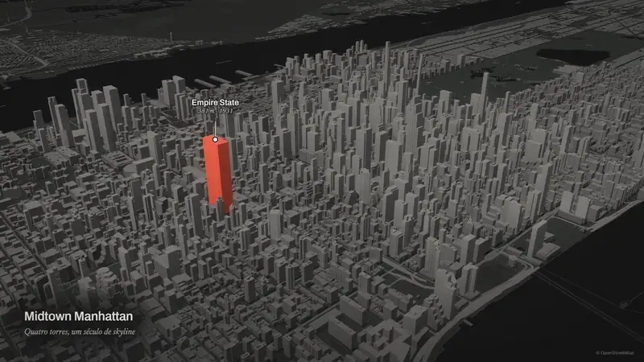
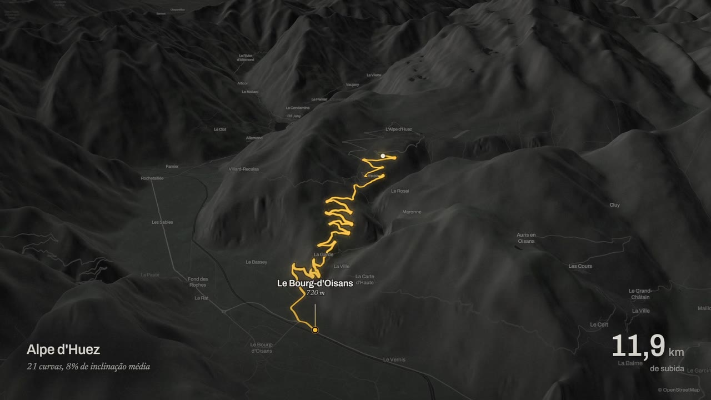
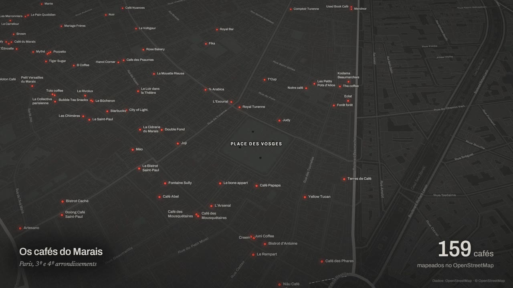
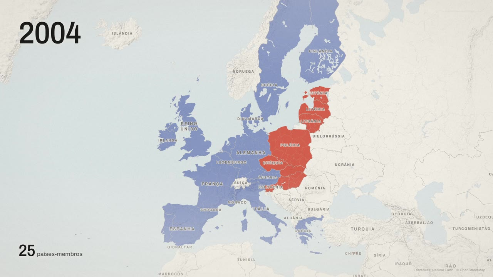
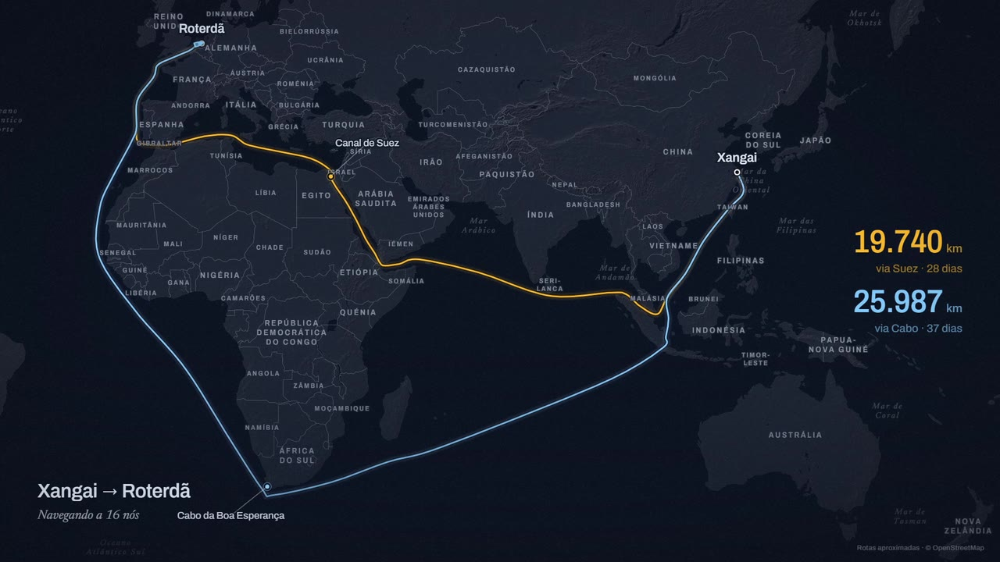
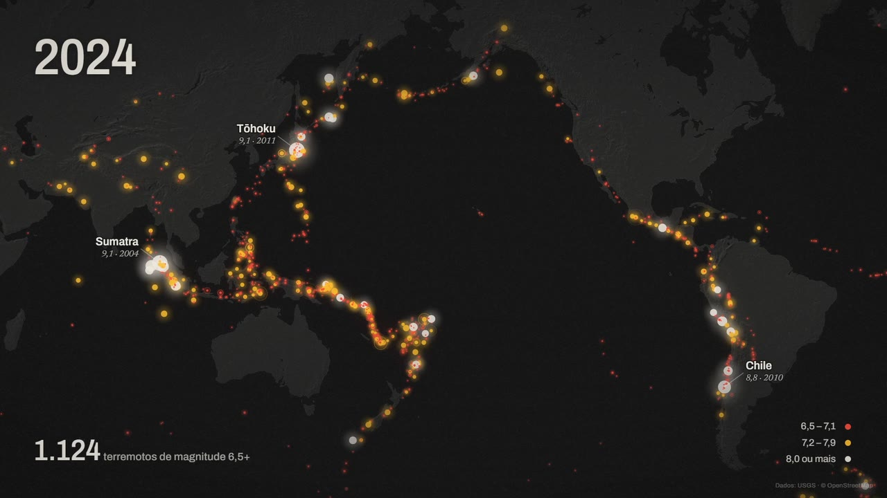
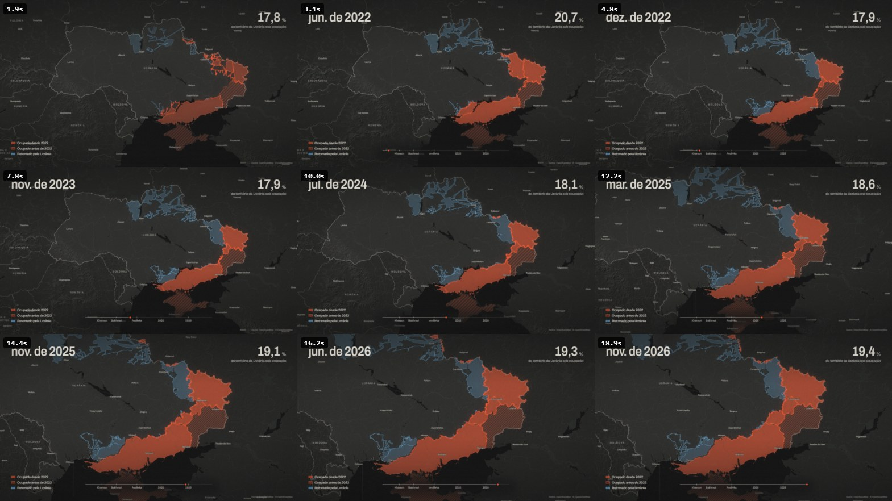
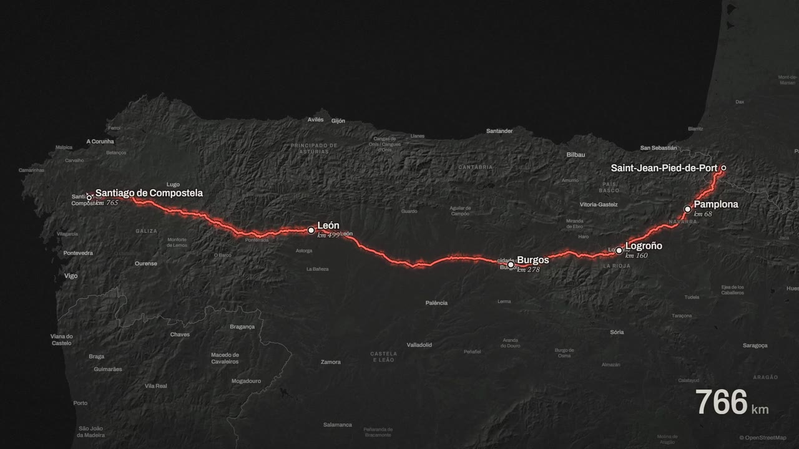

<h1 align="center">map-bamba</h1>

<p align="center">
  <b>2D and 2.5D map animations on real map data, from a few lines.</b><br>
  Real streets, real buildings, real places. Built to be driven by AI agents.
</p>

<p align="center">
  
</p>

<p align="center">
  <a href="#quick-start">Quick start</a> ·
  <a href="#recipes">Recipes</a> ·
  <a href="#gallery">Gallery</a> ·
  <a href="#for-ai-agents">For AI agents</a> ·
  <a href="docs/API.md">API</a> ·
  <a href="https://github.com/MusicMaster4/map-bamba/releases">Watch the videos</a>
</p>

---

map-bamba is to maps what Manim is to maths: you describe a video and get a finished,
broadcast-looking render. The description can be this short:

```json
{ "recipe": "route", "stops": ["Praça de Boa Viagem, Recife", "Praça de Casa Forte, Recife"],
  "title": "De Boa Viagem a Casa Forte", "sub": "Recife, Pernambuco", "lang": "pt" }
```

```bash
node bin/bamba.js render scenes/recife.json      # → out/recife.mp4, 1080p, in about 15 seconds on an RTX 3070
```

<p align="center"></p>

That brief geocodes both addresses, routes between them on real streets, extrudes the city in 2.5D,
flies in, follows the line as it draws, counts the kilometres and pulls back out. When a recipe does
not fit, the same result is ~20 lines of scene code with the full API.

## What's in the box

| | |
|---|---|
| **The real world** | Vector map of the whole planet (OpenStreetMap via OpenFreeMap): streets with names, building footprints with heights, land use, water, borders. Real terrain. A globe. |
| **Recipes** | Nine art-directed videos that take a JSON brief: `route`, `flight`, `tour`, `zoom`, `highlight`, `pois`, `orbit`, `events`, `compare`. `bamba eject` turns any brief into editable scene code. |
| **Data tools** | `s.route()` real routes on real streets · `s.geocode()` · `s.place()` real outlines of anything · `s.pois()` every café / station / museum in an area · `s.countries()` · great circles · splines. |
| **Motion** | A camera that flies, follows (looking ahead), orbits and drifts. Lines that draw themselves with a lit tip, outlines that trace before the fill arrives, points that pop in, buildings that rise. Optional motion blur. |
| **Typography** | Captions, titles, notes, counters, date tickers, legends, time bars, pins and labels — with entrance presets (`mask`, `rise`, `blur`, `words`, `chars`, `type`, `track`, `wipe`) and automatic label placement. |
| **A look** | Background `#151515` by default, drawing on top; three typefaces, a tight accent palette, relief shading, contact shadows under buildings, a little bloom, vignette and grain. Any background works: the whole map palette is derived from it. |
| **Fast, deterministic** | GPU-rendered in headless Chrome and encoded with NVENC / QuickSync / VideoToolbox. Frames are a pure function of time, so they render in parallel; finished frames are read straight off the GPU as YUV, with no screenshots in between. |
| **Checks that cost nothing** | `bamba check` reads a scene and reports, in text, what is wrong with it: text off the frame, overlaps, pins the camera never sees, wrong geocoding hits. |

## Quick start

Requirements: **Node 20+**, **ffmpeg** on your PATH, and **Chrome or Edge** (or run
`npx playwright-core install chromium`).

```bash
git clone https://github.com/MusicMaster4/map-bamba.git
cd map-bamba
npm install
node bin/bamba.js doctor                          # checks GPU, encoder, browser, network

node bin/bamba.js recipes                         # what can be made from a brief
node bin/bamba.js brief route my-video            # writes scenes/my-video.json and lists its keys
node bin/bamba.js check  scenes/my-video.json     # text report: problems, places looked up, timeline
node bin/bamba.js render scenes/my-video.json     # → out/my-video.mp4
```

| command | what it does |
|---|---|
| `bamba recipes` · `bamba brief <recipe> [name]` | List recipes · show a recipe's keys and example (and write `scenes/<name>.json`). |
| `bamba check <scene>` | Text-only check: problems found, what each place name resolved to, the timeline. |
| `bamba sheet <scene>` | Contact sheet: the 9 key moments in one image (`-n 12`, `--times 2,8,15`), plus the same problem list. |
| `bamba still <scene> -t 7.5` | One full-resolution PNG. |
| `bamba render <scene>` | The video. `--scale 2` for 4K, `--fps 60`, `--from 4 --to 8`, `--blur 8` (motion blur, experimental), `--crf 18`. |
| `bamba eject <brief.json>` | Turn a brief into an ordinary scene file to edit by hand. |
| `bamba new <name>` · `bamba help <topic>` | Blank scene file · API reference by topic (`camera`, `line`, `text`…). |
| `bamba preview <scene>` · `bamba doctor` | Scrub the scene live in a browser · environment check. |

A scene is either a brief (`.json`) or a scene file (`.js`); every command takes both.

## Recipes

| recipe | makes | brief |
|---|---|---|
| `route` | A → B (→ C…) on real roads. Short trips are a 2.5D follow shot; long journeys pin each stop with its km; `terrain: true` is a mountain climb. | `{ "recipe": "route", "stops": ["Lisboa", "Coimbra", "Porto"] }` |
| `flight` | Great-circle legs on a shaded globe, with a plane and a km counter. | `{ "recipe": "flight", "stops": ["São Paulo", "Lisbon", "Tokyo"] }` |
| `tour` | The camera visits several places in 2.5D, names each, then shows them all. | `{ "recipe": "tour", "stops": [{ "q": "Allianz Parque, São Paulo", "name": "Allianz Parque", "value": 43713 }, …], "unit": "lugares" }` |
| `zoom` | One continuous zoom from space to a place. | `{ "recipe": "zoom", "to": "Estádio do Maracanã, Rio de Janeiro" }` |
| `highlight` | Countries or regions lighting up group by group. | `{ "recipe": "highlight", "groups": [{ "label": "1991", "places": ["BR", "AR", "UY", "PY"] }] }` |
| `pois` | Every real establishment of a kind in an area, counted. | `{ "recipe": "pois", "area": "Le Marais, Paris", "tags": "amenity=cafe" }` |
| `orbit` | Orbit over a 2.5D skyline with buildings labelled at roof height. | `{ "recipe": "orbit", "center": "Midtown Manhattan", "landmarks": [{ "q": "Empire State Building, New York", "height": 381 }] }` |
| `events` | Dated points appearing in time, with a running date and count. | `{ "recipe": "events", "data": "https://…geojson", "fields": { "time": "properties.time" } }` |
| `compare` | Two or three routes between the same ends, each with its distance. | `{ "recipe": "compare", "routes": [{ "label": "by road", "stops": ["Lisboa", "Porto"] }, { "label": "straight", "arc": ["Lisboa", "Porto"] }] }` |

Every brief also takes `title`, `sub`, `lang`, `accent`, `theme`, `bg`, `duration`, `size`
(`"vertical"`, `"square"`) and `credit`.

## Gallery

Ten 20-second scenes written against the full API, each exercising a different part of the
framework. Sources are in [`examples/`](examples); the rendered videos are attached to the
[releases](https://github.com/MusicMaster4/map-bamba/releases).

<table>
<tr>
<td width="50%"><a href="examples/01-ucrania-front.js"></a><br><b>01 · Front line in Ukraine</b><br>Real front-line data every 10 days since April 2022: time-varying areas, date ticker, time bar, live percentage.</td>
<td width="50%"><a href="examples/02-recife-rota.js"></a><br><b>02 · A route through Recife</b><br>Boa Viagem to Casa Forte along real streets; follow camera over 2.5D buildings.</td>
</tr>
<tr>
<td><a href="examples/03-voo-sp-toquio.js"></a><br><b>03 · São Paulo → Tokyo</b><br>Great-circle flight across a shaded globe.</td>
<td><a href="examples/04-alpe-dhuez.js"></a><br><b>04 · Alpe d'Huez</b><br>The 21 hairpins on real 3D terrain, orbiting camera.</td>
</tr>
<tr>
<td><a href="examples/05-cafes-paris.js"></a><br><b>05 · The cafés of Le Marais</b><br>Every café in the district, with its real name, from OpenStreetMap.</td>
<td><a href="examples/06-uniao-europeia.js"></a><br><b>06 · The European Union, wave by wave</b><br>Choropleth on the light <code>paper</code> theme.</td>
</tr>
<tr>
<td><a href="examples/07-suez-ou-cabo.js"></a><br><b>07 · Suez or the Cape</b><br>Two shipping routes compared on the <code>night</code> theme.</td>
<td><a href="examples/08-manhattan-orbita.js"></a><br><b>08 · Midtown Manhattan</b><br>Orbit over a 2.5D skyline; real footprints extruded, labels pinned to rooftops.</td>
</tr>
<tr>
<td><a href="examples/09-terremotos.js"></a><br><b>09 · Every big earthquake since 2000</b><br>1,186 events from the USGS feed, appearing in time.</td>
<td><a href="examples/10-zoom-maracana.js"></a><br><b>10 · Earth to Maracanã</b><br>One continuous zoom from the whole planet to a stadium.</td>
</tr>
</table>

## For AI agents

Hand this repository to an agent with one sentence ("a 20 s video of the Camino de Santiago with
its main stops"). **[`AGENTS.md`](AGENTS.md)** is one short page: pick a recipe, write the brief,
run `check`, render. The full API is split by topic behind `bamba help <topic>`, so an agent reads
only the part it needs.

What keeps it cheap in tokens:

- **A brief instead of code.** Most requests are five to ten lines of JSON; the art direction
  (camera, timing, typography, label placement) is already in the recipe.
- **Text checks before images.** `bamba check` answers "is anything wrong?" in a few lines of text:
  overlaps, text off the frame, pins the camera misses, what each address was geocoded to, and the
  timeline. An image is only needed to judge taste.
- **One image when you do look.** `bamba sheet` puts the nine most telling moments (not nine evenly
  spaced ones) into a single image sized for vision models.

  

- **Errors that teach.** A wrong key, preset or recipe fails at once, names the line in your scene
  and lists the valid values.
- **Design rules written down** for custom scenes: the map is the hero, one accent colour, numbers
  over adjectives, no title cards.

### Measured with fresh agents

Each agent was given only the repository and one request; none could read the framework source.

| request | how it was made | tool calls | tokens | wall time |
|---|---|---|---|---|
| Camino de Santiago with its stops — *before recipes* (v0.1) | scene code, 5 contact sheets, 2 stills | 28 | 80 k | 5 min 25 s |
| The same request — now | `route` brief → `check` → `render` | 5 | 24 k | 1 min 08 s |
| "The three big stadiums of São Paulo", camera visiting each (no recipe existed) | custom scene via `bamba help` | 7 | 34 k | 2 min 06 s |

The second agent never opened an image; the frames it produced are below. The third agent's notes
are why the `tour` recipe exists — that request is now a six-line brief.

<p align="center"></p>

<p align="center"><br><sub>Every text style, entrance preset, pin and legend kind — <code>examples/extras/text-presets.js</code></sub></p>

## Themes

`theme: 'ink'` (default, `#151515`) · `'paper'` · `'night'` · `'blueprint'` — or just give a
background: `"bg": "#102418"`. Land, water, roads, buildings, labels and halos are all derived from
the background and ink colours, so any pair produces a coherent map.

## How it works

```
brief.json / scene.js ──▶ Scene (timeline: camera, map layers, overlay)        src/runtime/, src/recipes/
                              │  seek(t): a pure function of time
                              ▼
     headless Chrome: MapLibre GL (WebGL) + overlay ─▶ one canvas ─▶ YUV on the GPU ─▶ ffmpeg (NVENC…) ─▶ mp4
                              ▲                                                           src/node/
     local server: runtime + disk cache for tiles, routes, geocoding, POIs  (.bamba-cache/)
```

- The base map is a MapLibre style generated from two colours, drawn from OpenFreeMap vector tiles;
  map labels use the same typefaces as the overlay (SDF glyphs built from the bundled fonts).
- Lines, areas and points are real map layers: they drape over terrain and the globe and sit under
  labels. Text, pins and counters are HTML, anchored to coordinates (and to altitude, for rooftop labels).
- **Compositing.** With Chrome's HTML-in-canvas, the overlay is drawn into the same canvas as the
  map, so a finished frame is a single GPU surface. A small shader converts it to YUV 4:2:0
  (BT.709) and the bytes go straight into the encoder — no screenshot, no PNG, no colour
  conversion on the CPU. Browsers without the API fall back to screenshots.
- **Determinism.** MapLibre's clock is frozen and advanced frame by frame; the map is drawn exactly
  once per frame and line reveals are paint changes, not data reloads.
- **Parallelism.** The timeline is split across browser processes; a worker that finishes early
  takes half of the busiest worker's remaining frames. The number of workers follows the video
  memory that is actually free.

### Render speed

The ten example scenes (20 s each, 1080p30) rendered by v0.1 and by v0.2 on the same machine — an
RTX 3070, with nothing else using the GPU, each pair run back to back (`node scripts/bench.js`):

| scene | v0.1 | v0.2 | |
|---|---|---|---|
| 01 Ukraine front line | 26.7 s | 11.1 s | 2.4× |
| 02 Recife route (2.5D follow) | 30.5 s | 16.4 s | 1.9× |
| 03 São Paulo → Tokyo (globe) | 28.0 s | 12.3 s | 2.3× |
| 04 Alpe d'Huez (terrain) | 31.3 s | 11.6 s | 2.7× |
| 05 Cafés of Le Marais | 30.0 s | 11.5 s | 2.6× |
| 06 European Union | 34.2 s | 12.9 s | 2.7× |
| 07 Suez or the Cape | 26.0 s | 11.5 s | 2.3× |
| 08 Manhattan orbit (2.5D) | 63.8 s | 22.1 s | 2.9× |
| 09 Earthquakes | 26.2 s | 11.9 s | 2.2× |
| 10 Earth to Maracanã | 33.0 s | 13.0 s | 2.5× |
| **all ten** | **329.7 s** | **134.3 s** | **2.45×** |

The encoder settings did not change (NVENC, slowest preset, same quality target), and the encoder
is now the limit: it tops out near 85 frames per second at that preset. Against a lossless
reference frame, a frame encoded through the new capture path measured 33.54 dB PSNR and through
the old screenshot path 33.60 dB (one grain-heavy frame at the default quality), i.e. the same
picture. A GPU that is busy with something else slows renders several times over; the worker
count adapts to the video memory that is free.

Tested on Windows 11 with an NVIDIA GPU. Linux and macOS use the same code path (ANGLE GL / Metal,
VideoToolbox or libx264) but have had less testing — `bamba doctor` will tell you what it finds.

## Data and attribution

| | source | licence |
|---|---|---|
| Map tiles | [OpenFreeMap](https://openfreemap.org) (OpenMapTiles schema) from [OpenStreetMap](https://www.openstreetmap.org/copyright) | ODbL — keep the "© OpenStreetMap" credit the renderer adds |
| Routing | [OSRM](https://project-osrm.org) demo server, FOSSGIS routing | ODbL data; demo servers are for light use |
| Geocoding, outlines | [Nominatim](https://nominatim.org) | ODbL; max 1 request/s (the cache and pacing handle this) |
| Places | [Overpass API](https://overpass-api.de) | ODbL |
| Elevation | [Mapzen Terrain Tiles](https://registry.opendata.aws/terrain-tiles/) on AWS | see dataset attribution |
| Country outlines | [Natural Earth](https://www.naturalearthdata.com) 1:50m | public domain |
| Fonts | Archivo, Newsreader, JetBrains Mono | SIL OFL 1.1 (in `assets/fonts`) |
| Example 01 | [DeepStateMap](https://deepstatemap.live) | credited on screen |
| Example 09 | [USGS Earthquake Catalog](https://earthquake.usgs.gov) | public domain |

The public APIs above are free community services: map-bamba caches every answer on disk and paces
its requests, but for heavy production use, point it at your own tile server or routing instance.

## Licence

MIT — see [LICENSE](LICENSE). Rendered videos are yours; keep the OpenStreetMap credit.
